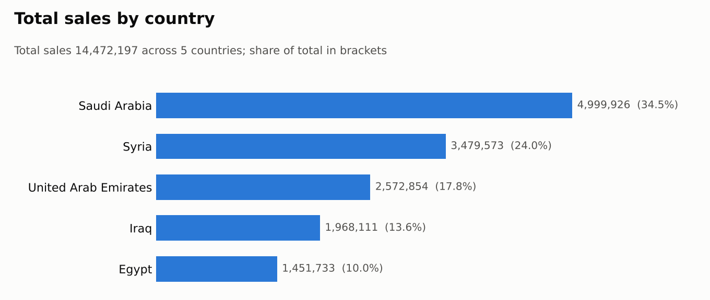
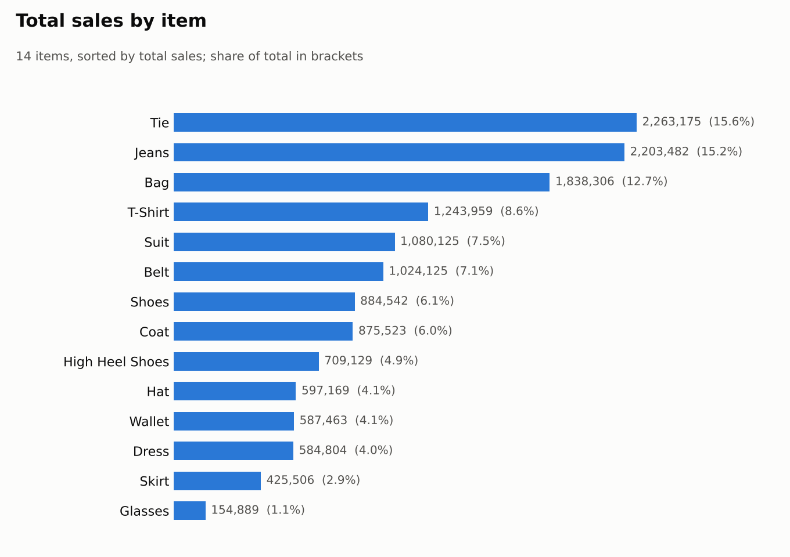
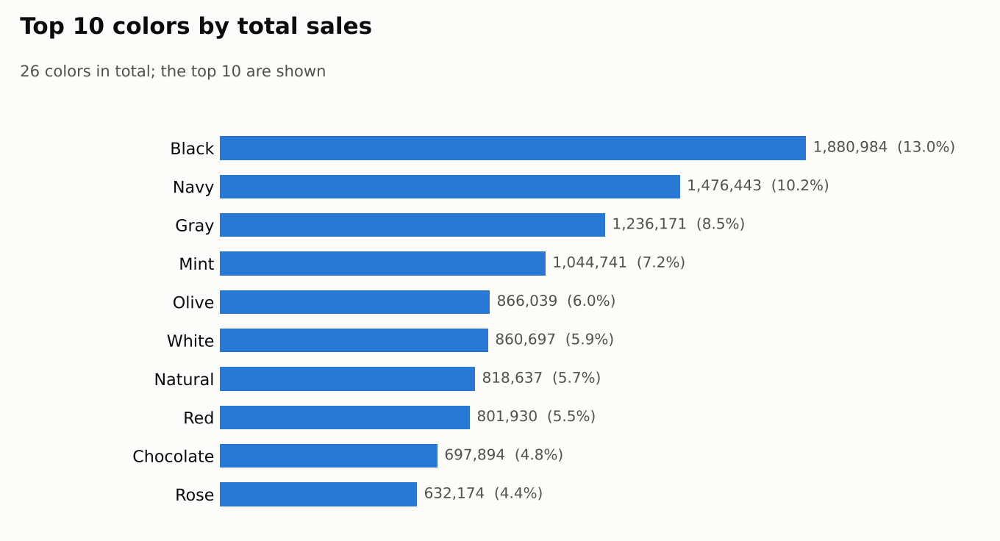

# Sales Analysis by Country, Item and Color (Excel PivotTables)

> An Excel PivotTable analysis of 7,902 units and 14.47M in total sales across 5 countries, 14 items and 26 colors. Saudi Arabia and Syria generate almost 59% of sales, and Tie and Jeans lead in every country.

## 🎯 Business Question

Where do sales come from, and which products drive them? Specifically:

- Which countries generate the most sales?
- Which items sell best, overall and in each country?
- Which colors are the best sellers?

## 📁 Data

- **Source:** Sales data used in a data analysis course assignment
- **Size:** 7,902 units sold, 482 country / item / color combinations
- **Countries:** Saudi Arabia, Syria, United Arab Emirates, Iraq, Egypt
- **Items (14):** Tie, Jeans, Bag, T-Shirt, Suit, Belt, Shoes, Coat, High Heel Shoes, Hat, Wallet, Dress, Skirt, Glasses
- **Measures:** Sum of Quantity, Total Sales

## 🛠️ Tools

Microsoft Excel: PivotTables with slicers

## 🔄 Process

1. **Organized the data** by country, then item, then color.
2. **Built PivotTables** showing Sum of Quantity and Total Sales for each combination.
3. **Summarized** total sales per country and per item to compare performance.
4. **Checked the totals:** the country and item summaries add up to the pivot's grand total of 14,472,197 in sales and 7,902 units.

## 🔍 Key Findings

- **Saudi Arabia and Syria generate 58.6% of total sales.** Saudi Arabia leads with 4,999,926 (34.5%), followed by Syria with 3,479,573 (24.0%).
- **Egypt is the smallest market** at 1,451,733 (10.0% of sales), and it also has the lowest average sales per unit (about 1,702, compared with about 1,831 overall).
- **Three items make up 43.6% of sales.** Tie (2,263,175), Jeans (2,203,482) and Bag (1,838,306) lead all 14 items.
- **Tie or Jeans is the #1 item in every country.** Tie leads in Egypt, Iraq and the UAE, and Jeans leads in Saudi Arabia and Syria.
- **Neutral colors dominate.** Black (13.0%), navy (10.2%) and gray (8.5%) together account for 31.7% of sales.
- **Glasses are the weakest item** at 1.1% of sales (154,889) and sold in only one color (indigo).

## ✅ Recommendations

- **Prioritize Saudi Arabia and Syria** in stock planning and marketing, since they drive most of the revenue.
- **Always keep Ties, Jeans and Bags well stocked** as the best sellers, and keep black, navy and gray options available.
- **Investigate Egypt's low average sales per unit** (pricing, product mix or discounting) before deciding whether to grow or hold that market.
- **Review the slowest items** (Glasses, Skirts) to decide whether to widen their color range or reduce stock.

## 📂 Files

- `workbook/sales-pivot-analysis.xlsx` – the Excel workbook with the PivotTables
- `images/` – charts used in this README

## 👤 Author

Mohamed EL Maghawry · [LinkedIn](https://www.linkedin.com/in/mohamed-el-maghawry-a60232b4) · maghawry.17@gmail.com
